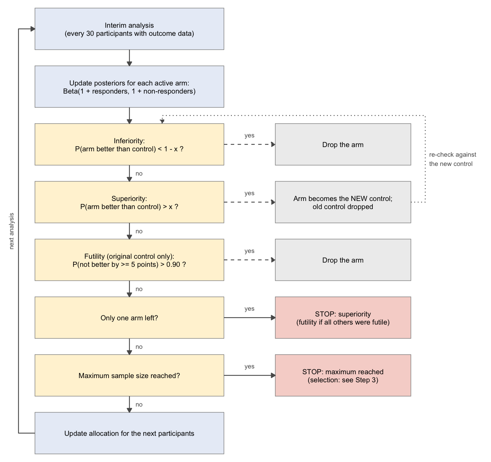
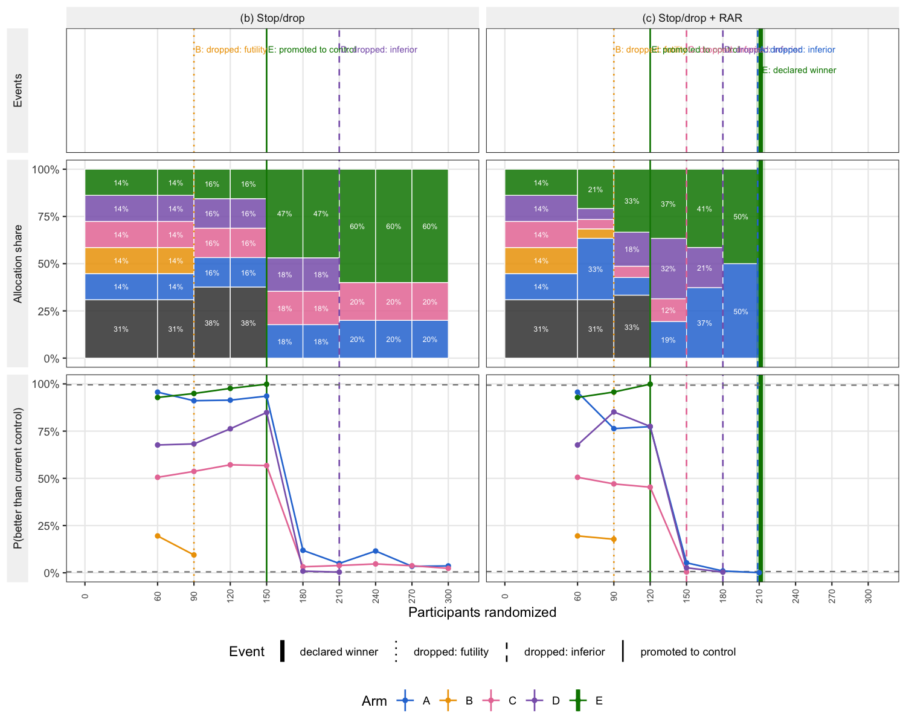
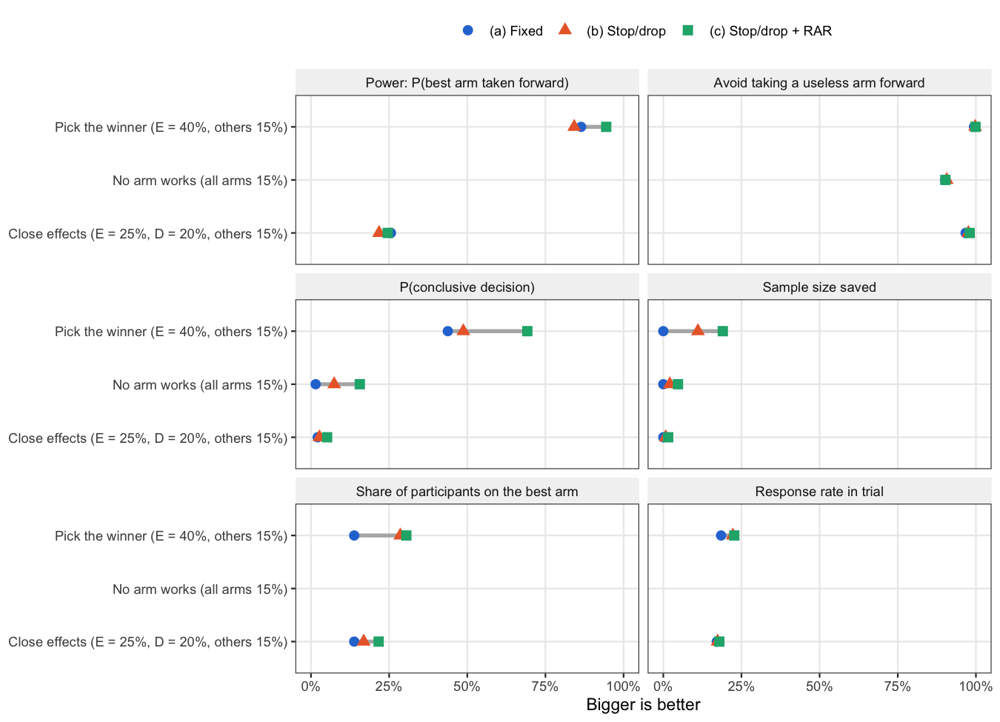
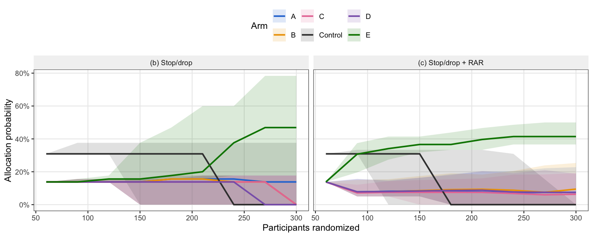

# Bayesian adaptive designs: a worked example using `adaptr`
Leontine Alkema
2026-10-27

> [!NOTE]
>
> ### About this post
>
> This post is part of my
> [sandbox](https://github.com/leontinealkema/bayes-trials-sandbox) of
> worked examples on Bayesian methods for clinical trial design. The
> examples use simple settings to show how a method works; they are not
> design recommendations. Questions, corrections and suggestions are
> very welcome!

Phase II trials may test several candidate treatments to decide which
one, if any, deserves a large confirmatory phase III trial. A
conventional design randomizes a fixed number of participants to each
arm and looks at the data once, at the end. A Bayesian adaptive design
looks at the data repeatedly as they come in and acts on what it sees:
it drops arms that are unlikely to help, stops when a winner is clear,
and can steer new participants toward arms that look promising.

This post is a 101 on adaptive designs. Using an example trial, I set up
a fixed design and two adaptive designs, and compare them in three
scenarios. It is not a full overview of adaptive designs and their pros
and cons, just an introduction to what they are and how they behave.

All results come from simulations and analysis with the R package
[adaptr](https://inceptdk.github.io/adaptr/index.html), version 1.5.0
([Granholm and Kaas-Hansen 2026](#ref-adaptr2026); [Granholm et al.
2022](#ref-granholm2022), [2025](#ref-granholm2025)). The package
handles many types of trials and designs and is a great resource.

> [!TIP]
>
> ### What you can get out of this post
>
> I wrote this post to understand how Bayesian adaptive designs work in
> practice, beyond the general idea of “looking at the data as they come
> in”. It walks through one example trial from start to finish. After
> reading it, you should be able to:
>
> - explain the building blocks of a Bayesian adaptive design: interim
>   analyses, stopping, dropping arms, and response-adaptive
>   randomization;
> - see why adaptive designs need a stricter decision threshold, and how
>   that threshold is set by simulation;
> - read the operating characteristics of a design (power, false-go
>   rate, sample size, participant benefit) and compare designs across
>   scenarios;
> - judge when adaptation helps (one arm clearly works) and when it does
>   not (no arm works, or effects that are too small for the trial).
>
> All code is in the repository, so you can rerun the simulations or
> change the settings.

# The trial

**Objective.** Five candidate treatments, A–E, are compared with
standard care (the ***control***, arm 0). The trial has to reach a
***go/no-go decision***: take one of A–E forward to phase III (a *go*),
or none of them (a *no-go*). This is a selection question, not a
confirmatory one: the aim is to find the arm worth a large trial, if
there is one.

**Participants and endpoint.** At most *300 participants* are
randomized. The endpoint is a binary *response* (say, tumor response)
that is known soon after treatment (the simulations assume no delay:
each outcome is available at the next analysis). For participant $i$ on
arm $k \in \{0, A, \dots, E\}$, the endpoint $y_i$ is the outcome of a
Bernoulli draw, $y_i|p_{k[i]} \sim \text{Bernoulli}(p_{k[i]}),$ where
$p_k$ is the unknown response rate of arm $k$ and $k[i]$ refers to the
arm of participant $i$.

**Prior and posterior densities for** $p_k$. We consider Bayesian
designs, where decisions are made based on posterior probabilities. We
use a simple setup with a uniform $\text{Beta}(1, 1)$ prior for each
$p_k$. With $s_k$ responses among $n_k$ participants, its posterior is
$p_k \mid \text{data} \sim \text{Beta}(1 + s_k,\; 1 + n_k - s_k)$.

**Decision criterion.** The question for each arm is whether it is
better than the control, $p_k > p_0$. With the posterior densities
introduced above, the probability that arm $k$ has a higher response
rate than the control is given by $P(p_k > p_0 \mid \text{data})$. We
set the decision criterion to take an arm forward based on this
probability: an arm can only be taken forward if this probability
$P(p_k > p_0 \mid \text{data})$ exceeds a **threshold** $x$ close to 1
(more on how $x$ is obtained later). E.g., if $x=0.98$, and an arm
exceeds the threshold, the interpretation is as follows: we take arm $k$
forward if we are at least 98% sure that this arm is better than
standard care.

**Operating characteristics.** The decision rule can go wrong in
different ways, through a false go (taking forward a non-superior arm,
i.e., a useless treatment is sent on to an expensive phase III trial)
and a false no-go (not taking forward a superior arm). These error rates
are frequentist properties that we can approximate by simulating many
trials with known true response rates. We consider:

- **False-go rate:** the probability of a go when *no* arm is better
  than the control. In scenarios where there is a better arm, we report
  the related probability that a useless arm (one no better than the
  control) is taken forward.
- **Power:** the probability that the *best arm is taken forward* when
  one arm is truly better.

**Scenarios.** Operating characteristics depend on the true response
rates, so they are computed under an assumed set of rates, a *scenario*.
In the examples here, we assume that standard care has a response rate
of 15%, and we consider three scenarios:

| Scenario            | True response rates              |
|---------------------|----------------------------------|
| **Pick the winner** | E 40%, all other arms 15%        |
| **No arm works**    | All arms 15%                     |
| **Close effects**   | E 25%, D 20%, all other arms 15% |

**Choosing the threshold** $x$ **in the decision criterion.** The value
for $x$ sets the trade-off between the two errors: a stricter (higher)
$x$ lowers the false-go rate, but it also lowers the power. We choose
$x$ such that the false-go rate in the null scenario (“No arm works”, in
which no arm is better than the control) is at most **10%**, a common
error level for phase II, and then look at the power that each design
achieves. This step is called *calibration*; the next section explains
how it is done for each design.

# Designs

We consider a fixed design and two adaptive designs.

## Fixed design

The conventional fixed design randomizes all 300 participants and
analyzes the data **once**, at the end.

**Allocation.** We follow the square-root allocation approach ([Viele et
al. 2020](#ref-viele2020control)) to (approximately) maximize the
precision of the comparisons with control. In this approach, with $K$
experimental arms, the control gets $\sqrt{K}$ shares and each
experimental arm one share, so relatively, the control’s share is
$\sqrt{K} / (\sqrt{K} + K)$. For our setting with $K = 5$, that is about
93 participants on control and 41 on each experimental arm.

**Decision.** At n = 300, compute $P(p_k > p_0 \mid \text{data})$ for
each of the five experimental arms. If at least one exceeds $x$, it is a
go and the most promising arm is taken forward. Otherwise, keep the
control (a no-go).

**Choosing** $x$. We choose $x$ such that the false-go rate is at most
10% in the null scenario (“No arm works”). We obtain the value through
simulation (see [Calibrating the designs](#calibrating-the-designs)):
$x =$ 0.977.

<!-- This is close to a simple approximation. Under the null scenario, each arm's $P(p_k > p_0 \mid \text{data})$ exceeds $x$ with probability of about $1 - x$. If the five comparisons were independent, the false-go rate would be $1 - x^5$, and setting this to 10% gives $x =$ 0.979. The comparisons share the control, which makes them positively correlated, so a slightly lower threshold suffices. -->

## Adaptive designs

We introduce two adaptive designs. These designs use the same decision
criterion and the same maximum sample size of 300 as the fixed design
but analyze the data repeatedly. We consider the stop/drop design and
the stop/drop design with additional response-adaptive randomization
(RAR). An overview of designs is given in the table:

| Design | Interim analyses, stopping, arm dropping | Response-adaptive randomization (RAR) |
|----|----|----|
| **(a) Fixed** | No: one analysis at n = 300 | No |
| **(b) Stop/drop** | Yes: every 30 participants, from n = 60 | No |
| **(c) Stop/drop + RAR** | Yes: same schedule as (b) | Yes |

Both designs allocate the first 60 participants with the same
square-root rule as the fixed design. From n = 60 onwards, an interim
analysis is carried out every 30 participants.
<a href="#fig-flowchart" class="quarto-xref">Figure 1</a> summarizes one
interim analysis; the three steps below go through it.

Figure 1: One interim analysis in adaptive designs (b) and (c). Dashed
arrows: an action on that arm, after which the analysis continues.
Arrows to red boxes: the trial stops.

### Step 1: update the posteriors and apply the rules

At each analysis, each experimental arm $k$ is compared with the
**current control** $c$. At the start, $c$ is the original control, arm
0; after a promotion (see below), $c$ is the promoted experimental arm.
Three checks are carried out (how $x$ is set for the adaptive designs is
explained below):

- **Inferiority:** if $P(p_k > p_c \mid \text{data}) < 1 - x$, arm $k$
  is convincingly worse, and it is **dropped**.
- **Superiority:** if $P(p_k > p_c \mid \text{data}) > x$, arm $k$ is
  convincingly better than the current control. It becomes the **new
  control**, and the old control is dropped. If more than one arm beats
  the current control, the arm with the highest
  $P(p_k > p_c \mid \text{data})$ becomes the new control. The remaining
  arms are then checked again against the new control.
- **Futility:** if $P(p_k - p_0 < 0.05 \mid \text{data}) > 0.90$, arm
  $k$ is unlikely to beat the original control by a clinically relevant
  5 percentage points, and it is **dropped**. This check is only made
  until the first promotion; after that, arms are dropped only for
  inferiority.

When only one arm is left, or the maximum sample size is reached, the
trial stops.

### Step 2: allocate the next participants

After the decisions, the allocation probabilities for the next 30
participants are set.

- **Design (b)** keeps the same allocation probabilities until an arm is
  dropped. A dropped arm gets no more participants; from then on, new
  participants are randomized over the remaining arms only. If an
  experimental arm is promoted to control, it takes over the control’s
  share.
- **Design (c)** recalculates the allocation probabilities at every
  analysis. The control keeps a protected share, and the rest goes
  mostly to the experimental arms with the highest probability of being
  the best arm, $P(p_k = \max_j p_j \mid \text{data})$.

> [!NOTE]
>
> ### Details: allocation rules
>
> **Design (b).** When an arm is dropped, the control’s weight is
> recalculated with the square-root rule for the number of experimental
> arms still active, while each remaining experimental arm keeps its
> starting weight. The weights are then rescaled to sum to 1. The
> control therefore gains the most: its share grows from 31% with five
> experimental arms to 60% with two. (Applying the square-root rule to
> all remaining arms would instead give the control 41% with two
> experimental arms.)
>
> **Design (c).** At each analysis:
>
> 1.  the control gets the square-root share for the number of
>     experimental arms still active;
> 2.  the rest is split among the active experimental arms in proportion
>     to $P(p_k = \max_j p_j \mid \text{data})^{0.7}$ (the power
>     $0.7 < 1$ “softens” the shares toward equal allocation, so that
>     early noise does not cause wild swings ([Thall and Wathen
>     2007](#ref-thall2007))), with a minimum share for each active
>     experimental arm: 5% at the start, rescaled upward as arms are
>     dropped (10% with two arms left).
>
> The probability of being best is computed among all active arms,
> including the control; only the shares of the experimental arms depend
> on it.
>
> **Settings in adaptr.** In `adaptr::setup_trial_binom()`, design (b)
> uses `control_prob_fixed = "sqrt-based fixed"`. Design (c) uses
> `control_prob_fixed = "sqrt-based"`, `soften_power = 0.7`,
> `min_probs = 0.05` for each experimental arm and
> `rescale_probs = "limits"`.

### Step 3: the final decision

A trial ends in one of two ways:

- **One arm is left.** If it is an experimental arm, this is a **go**.
- **The maximum of 300 is reached with several arms still active.** If
  the original control is still in the trial, it is a **no-go**. If the
  original control has been dropped, which means some arm beat it based
  on superiority, the active arm with the highest probability of being
  best is selected and is a **go**.

### A simulated example trial

<a href="#fig-anatomy" class="quarto-xref">Figure 2</a> shows one
simulated trial under the two adaptive designs. In this trial, arm E
truly works (response rate 40%, all other arms 15%). Up to the first
analysis both designs see the same participants; after that they
diverge. In design (c), RAR quickly sends more participants to the arms
that look best so far, and one useless arm is dropped for futility early
on. E beats the control at n = 120 and becomes the new control. The
remaining arms are then dropped one by one as it becomes clear that they
are worse than E, and the trial stops with E as the winner at n = 210,
well before the maximum of 300. In design (b), E also beats the control,
but later (n = 150). Two useless arms are never dropped, so the trial
runs to the maximum of 300 and then takes E forward.

Figure 2: One simulated trial. Top: events (vertical lines, color =
arm). Middle: how the next set of participants is divided over the
active arms (one stacked bar per interval between analyses). Bottom:
each arm’s probability of being better than the current control, with
the thresholds x and 1 - x as dashed lines.

## Calibrating the designs

For each design, we choose the threshold $x$ such that the false-go rate
in the null scenario (“No arm works”) is at most 10%. Recall that $x$ is
how sure we need to be that an arm is better than the (current) control
before it beats the control: an arm beats the control if
$P(p_k > p_c \mid \text{data}) > x$. In the adaptive designs, $1 - x$ is
also the inferiority threshold: an arm is dropped if
$P(p_k > p_c \mid \text{data}) < 1 - x$.

The false-go rate is found by simulation: for a candidate value $x$, we
simulate 5,000 trials under the null scenario and count how often an arm
other than the control is taken forward. A search algorithm
(`adaptr::calibrate_trial()`) repeats this until the false-go rate is at
or just below 10%, and the threshold is then rounded up to four
decimals.

The table below gives the thresholds for the three designs. Because
adaptive designs look at the data several times, they need a stricter
threshold than the fixed design to end up at the same false-go rate. The
thresholds are 0.995 for (b) and 0.993 for (c), versus 0.977 for the
fixed design.

| Design                | Superiority threshold | Inferiority threshold |
|:----------------------|----------------------:|----------------------:|
| \(a\) Fixed           |                0.9770 |                    \- |
| \(b\) Stop/drop       |                0.9950 |                0.0050 |
| \(c\) Stop/drop + RAR |                0.9933 |                0.0067 |

# Comparing designs under different scenarios

Each design was simulated 5,000 times in each of the three scenarios
introduced in [The trial](#the-trial).

## Results

<!-- The Monte Carlo standard error of an estimated probability is then at most 0.7 percentage points, so differences of about a percentage point are within simulation noise. "No arm works" is the null scenario used for calibration, so there the false-go rate is at or just below 10% by construction. -->

<a href="#fig-scenarios" class="quarto-xref">Figure 3</a> and the table
below summarize the operating characteristics of each design in each
scenario. The figure shows six metrics, all on a 0–100% scale where
**bigger is better**:

- **Power**, the share of trials in which the best arm is taken forward,
  and **avoiding a false go**, one minus the share of trials in which an
  arm that is no better than the control is taken forward;
- **a conclusive decision**: only one arm is left at the end, rather
  than reaching the maximum sample size with several arms still active
  (for the fixed design, this happens only if all other arms are dropped
  at its single analysis);
- **sample size saved**: one minus the expected sample size as a share
  of the maximum;
- **participant benefit**: the share of trial participants randomized to
  the best arm, and the response rate among all trial participants.

The table gives four key metrics on their original scale: the expected
sample size, power, the false-go rate, and the probability of a no-go
(the control is kept). Metrics that need a best arm are left out of the
“No arm works” scenario.

Figure 3: Performance by scenario. Metrics are all on a 0–100% scale
where bigger is better.

| Scenario | Metric | \(a\) Fixed | \(b\) Stop/drop | \(c\) Stop/drop + RAR |
|:---|:---|---:|---:|---:|
| Pick the winner | Expected sample size | 300 | 267 | 243 |
|  | Power: P(best arm taken forward) | 0.86 | 0.84 | 0.94 |
|  | P(false go: a useless arm taken forward) | 0.01 | 0.00 | 0.00 |
|  | P(no-go: control taken forward) | 0.13 | 0.16 | 0.05 |
| No arm works | Expected sample size | 300 | 294 | 286 |
|  | P(false go: a useless arm taken forward) | 0.10 | 0.09 | 0.10 |
|  | P(no-go: control taken forward) | 0.90 | 0.91 | 0.90 |
| Close effects | Expected sample size | 300 | 298 | 295 |
|  | Power: P(best arm taken forward) | 0.26 | 0.22 | 0.25 |
|  | P(false go: a useless arm taken forward) | 0.03 | 0.02 | 0.02 |
|  | P(no-go: control taken forward) | 0.64 | 0.70 | 0.68 |

Key metrics per scenario

## Main takeaways per scenario

**Pick the winner (E works, four arms are useless).** This is the
setting adaptive designs are made for. Design (c) has a power of 94% (E
is taken forward), compared with 86% for the fixed design, and uses 243
participants on average instead of 300. Design (b) saves participants
too (267 on average), but has slightly *lower* power than the fixed
design (84%), because its stricter threshold costs some power (the
difference is larger than the simulation error).

Design (c) seems to do better than design (b) because RAR sends more
participants to E early on. Between n = 60 and 90, the median share of
new participants going to E is 31% in design (c) versus 14% in design
(b). E therefore beats the control sooner and more often before the
maximum, and the share of trials ending in a no-go drops from 16% in
design (b) to 5% in design (c). Over the whole trial, E gets about as
many participants in (b) as in (c) (76 versus 74 on average), because in
(b) a promoted E takes over the control’s large share, but this happens
late.

<a href="#fig-history" class="quarto-xref">Figure 4</a> shows this over
the course of the trial, across 500 simulated trials per design. In
design (c), the share of new participants going to E rises right after
the first analysis; in design (b), it stays at its starting value until
arms are dropped or E becomes the new control.

Figure 4: Pick the winner: allocation probabilities over the course of
the trial (computed with adaptr::plot_history()). Line: median; band:
middle 50% of trials. Each point refers to the trials still running at
that sample size; a dropped arm has probability 0.

**No arm works.** All three designs take a useless arm forward in 9.9%,
9.3% and 9.8% of trials (fixed, b, c), at or just below the 10% target,
as calibrated. The adaptive designs save only a few participants here
(294 and 286 versus 300). Dropping an arm does not shorten the trial,
because its places go to the other arms; the trial only stops early once
one arm is left. That happens in just 7% (b) and 16% (c) of trials: with
arms of 15% and a 5-point futility margin, evidence that *every* arm is
futile accumulates slowly.

**Close effects (E 25%, D 20%).** Every design struggles: power is only
22%–26%, and most trials end in a no-go (64%–70%). A 10-point difference
is simply too small for 300 participants spread over six arms, and
adaptation cannot fix an underpowered trial.

**Participant benefit.** When an arm works, the adaptive designs put
more of the trial’s participants on it. In pick the winner, the share of
participants randomized to E is 14% in the fixed design, 29% in design
(b) and 31% in design (c), and the response rate among all trial
participants rises from 18% to 22% and 23%. In design (b), most of this
gain comes late, after E has beaten the control and taken over the
control’s share; RAR in design (c) shifts participants to E earlier.
With close effects the gains are smaller: the share on E is 14%, 17% and
22%, and the response rate 17.1%, 17.4% and 17.9% (fixed, b, c). When no
arm works, there is nothing to gain: every participant has the same 15%
chance of response, whatever the design.

## What this post leaves out

The goal of this post was to use simple settings to show how adaptive
designs work, so many aspects are left out. Here are some of them…

**Estimation.** After a go, the trial also gives an estimate of how much
better the selected arm is. That estimate tends to be too high in every
design, because an arm is only taken forward when it looks good. In the
pick-the-winner scenario, the adaptive designs make this somewhat worse:
they tend to stop when the winner looks unusually good, and with fewer
participants their estimates are noisier. (With close effects it is the
other way around, because the fixed design only says go when its
estimate is extreme.) How large this bias is, and what can be done about
it, may be a topic for a later post.

**Other design choices.** The simulations assume that each outcome is
known before the next analysis; with delayed outcomes, interim decisions
are based on less information. They also assume that response rates stay
constant during the trial. In practice, rates can drift (for example, as
the population enrolled changes), which can bias comparisons when
allocation probabilities change over time, as with RAR. Finally, the
futility margin (5 percentage points), the futility probability (0.90),
the interim schedule and the RAR settings were fixed here. They all
affect the operating characteristics, and a real design would explore
them.

And then of course there is the **prior** on $p_k$! We used a uniform
$\text{Beta}(1, 1)$ for every arm, but other priors (say, an informative
prior for the control based on historical data) change the posterior
probabilities, and with them the operating characteristics and the
calibrated threshold. More on that in a later post for sure!

# Summary

Adaptive designs look at the data as they come in and act on them. In
this example, that pays off most when one arm clearly works: with
response-adaptive randomization, design (c) takes the best arm forward
more often than the fixed design (94% versus 86%), with fewer
participants (243 versus 300 on average), and puts more of the trial’s
participants on the better treatment. When no arm works, or when effects
are small, the gains are small: adaptation does not fix a trial that is
too small for its question.

**Code.** All code for this post is in the
[`adaptive-designs/`](https://github.com/leontinealkema/bayes-trials-sandbox/tree/main/adaptive-designs)
folder of the repository: `run_all.R` runs and caches all simulations,
`R/helpers.R` holds the helper functions, and this post only reads the
saved results in `results/`.

# References

Granholm, Anders, Aksel Karl Georg Jensen, Theis Lange, and Benjamin
Skov Kaas-Hansen. 2022. “adaptr: An R
Package for Simulating and Comparing Adaptive Clinical Trials.” *Journal
of Open Source Software* 7 (72): 4284.
<https://doi.org/10.21105/joss.04284>.

Granholm, Anders, Aksel Karl Georg Jensen, Theis Lange, Anders Perner,
Morten Hylander Møller, and Benjamin Skov Kaas-Hansen. 2025. “Designing
and Evaluating Bayesian Advanced Adaptive Randomised Clinical Trials: A
Practical Guide.” *Pharmaceutical Statistics* 24 (6): e70042.
<https://doi.org/10.1002/pst.70042>.

Granholm, Anders, and Benjamin Skov Kaas-Hansen. 2026.
*adaptr: Adaptive Trial Simulator*.
<https://CRAN.R-project.org/package=adaptr>.

Thall, Peter F., and J. Kyle Wathen. 2007. “Practical Bayesian Adaptive
Randomisation in Clinical Trials.” *European Journal of Cancer* 43 (5):
859–66. <https://doi.org/10.1016/j.ejca.2007.01.006>.

Viele, Kert, Kristine Broglio, Anna McGlothlin, and Benjamin R. Saville.
2020. “Comparison of Methods for Control Allocation in Multiple Arm
Studies Using Response Adaptive Randomization.” *Clinical Trials* 17
(1): 52–60. <https://doi.org/10.1177/1740774519877836>.

